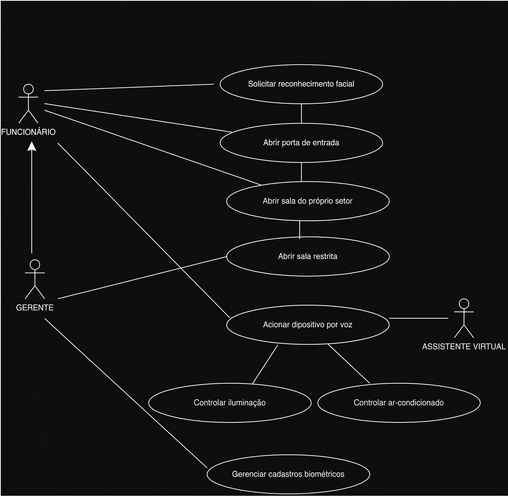
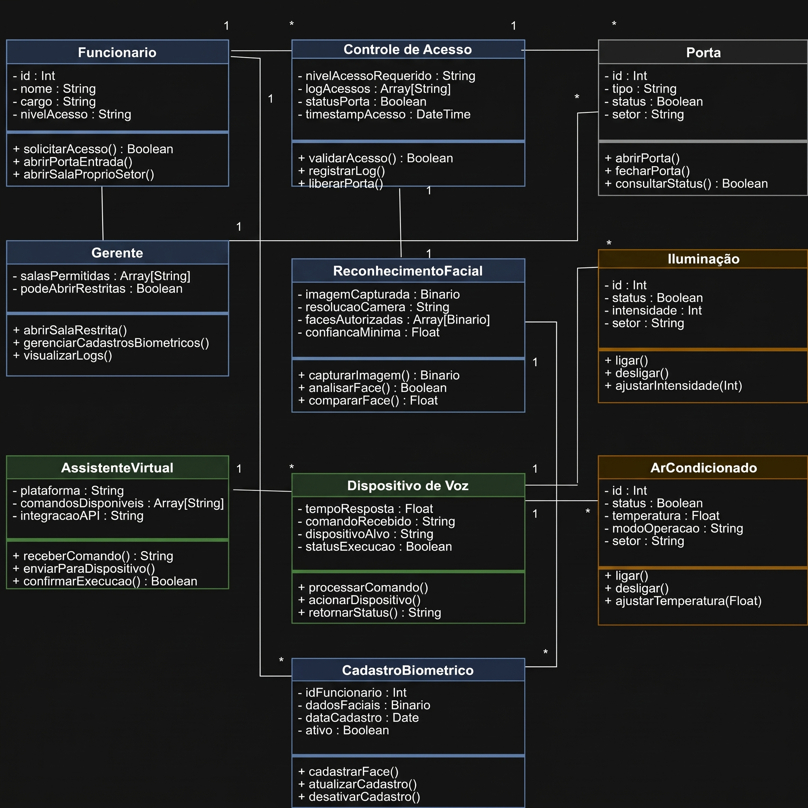

  
─────────────────────── ✦ ───────────────────────

  <h1>˚₊‧꒰ა Controle de Acesso Inteligente & Automação IoT (UML) ໒꒱‧₊˚</h1>

  

    <i>Estudo de caso de engenharia de software com requisitos, Casos de Uso e Diagrama de Classes para prédio inteligente com biometria facial e automação por voz.</i>
  

  

    
    
    
  

 

### ✦ Resumo

Documenta a análise e a modelagem UML de um sistema corporativo de segurança física e automação predial com reconhecimento facial, assistentes virtuais (**Alexa** e **Google Home**), sensores de presença, painel web administrativo e controle por aplicativo mobile.

### ✦ Tecnologias

- **UML (Linguagem Unificada de Modelagem):** Utilizada para especificar fluxos de interação no Diagrama de Casos de Uso e a estrutura orientada a objetos no Diagrama de Classes.
- **Engenharia de Requisitos:** Organização e separação entre requisitos funcionais (`RF`) e requisitos não funcionais (`RNF`) para guiar o escopo técnico e operacional do projeto.

### ✦ Regras

#### Requisitos Funcionais (`RF`)

- **RF01 – Reconhecimento Facial:** Liberação automática de portas por meio de reconhecimento facial.
- **RF02 – Comandos de Voz:** Controle de iluminação e ar-condicionado por assistentes virtuais (Alexa ou Google Home).
- **RF03 – Gestão Biométrica:** Cadastro facial e definição de permissões por perfil (*Funcionário* e *Gestor*).
- **RF04 – Painel Web Administrativo:** Interface web para gerenciamento de acessos pelo RH e pela gestão.
- **RF05 – Economia de Energia:** Desligamento automático de luzes e ar-condicionado acionado por sensores de presença.
- **RF06 – Controle Mobile:** Gerenciamento remoto de dispositivos por aplicativos Android e iOS.

#### Requisitos Não Funcionais (`RNF`)

- **RNF01 – Desempenho:** Tempo de resposta no processamento de comandos de voz menor que `2 segundos`.
- **RNF02 – Qualidade de Hardware:** Câmeras de segurança com resolução mínima `1080p (Full HD)`.
- **RNF03 – Estética:** Sensores físicos no padrão de cor cinza ou branco.
- **RNF04 – Conectividade:** Comunicação em rede local entre o servidor e os dispositivos IoT.
- **RNF05 – Orçamento:** Custo total de hardware e software limitado a `R$ 25.000,00`.
- **RNF06 – Integridade de Dados:** Armazenamento consistente dos registros de acesso no banco de dados.

─────────────────────── · ───────────────────────

### ✦ Diagramas UML

#### 1. Diagrama de Casos de Uso

#### 2. Diagrama de Classes

─────────────────────── · ───────────────────────

### ✦ Como Foi Construído

- **Modelagem Orientada a Objetos:** Estruturação de herança (`Funcionário` → `Gestor`), composição e associações entre controle de acesso, porta, reconhecimento facial, assistente virtual, iluminação e ar-condicionado.
- **Engenharia de Requisitos:** Separação clara entre o que o sistema faz (`RF01` a `RF06`) e as restrições de desempenho, hardware, rede, orçamento e integridade de dados (`RNF01` a `RNF06`).
- **Notação UML:** Aplicação de atores, relacionamentos `<<include>>` e `<<extend>>`, visibilidade (`+` e `-`), atributos tipados e operações no Diagrama de Casos de Uso e no Diagrama de Classes.

 

  
°•. ✦ .•° ────── ꒰ ✦ ꒱ ────── °•. ✦ .•°

  
<i>Feito por <b>Eduarda Gonçalves</b></i>

